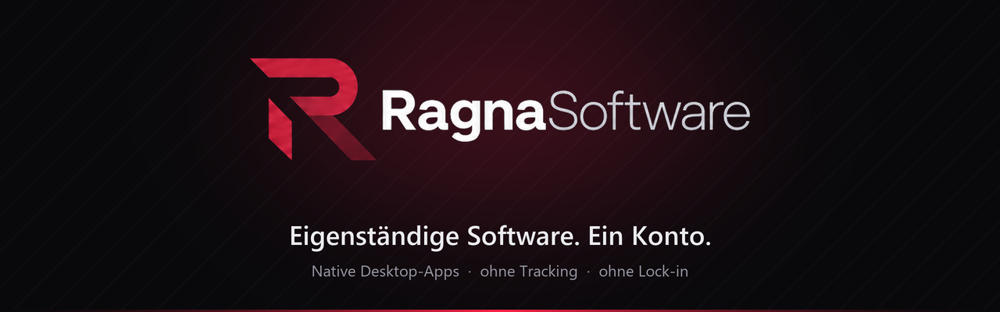
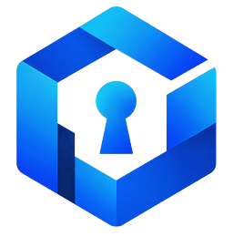

  

  
  
  
  

## Wer wir sind

**RagnaSoftware** ist ein unabhängiges Software-Projekt. Wir bauen schnelle Desktop-Apps, die deine Daten respektieren – **ohne Tracking und ohne Lock-in** – und verbinden sie über **ein einziges Konto: RagnaID**. Sensible Daten werden auf deinem Gerät verschlüsselt.

<table>
  <tr>
    <td width="50%" valign="top">
      
      <h3>Deine Daten bleiben deine</h3>
      Kein Tracking. Was sensibel ist, wird direkt auf deinem Gerät verschlüsselt – bevor es irgendwohin geht.
        
      <b>Zum Beispiel:</b> RagnaVault ist Zero-Knowledge. Dein Master-Passwort verlässt nie dein Gerät.
    </td>
    <td width="50%" valign="top">
      
      <h3>Unabhängig, ohne Lock-in</h3>
      Eigenständige Apps, die nicht von einer Cloud abhängen. Du entscheidest, wo deine Daten liegen.
        
      <b>Zum Beispiel:</b> RagnaVault läuft komplett offline – Konto und Sync sind freiwillig.
    </td>
  </tr>
  <tr>
    <td width="50%" valign="top">
      
      <h3>Ein Konto für alles</h3>
      Eine RagnaID für alle Produkte statt einem Login pro App. Wo es geht, bleibt sie optional.
        
      <b>Zum Beispiel:</b> RagnaVault und RagnaClip nutzen dieselbe RagnaID – einmal registrieren genügt.
    </td>
    <td width="50%" valign="top">
      
      <h3>Schnell und schlank</h3>
      Native Desktop-Apps, die sofort starten und kaum Ressourcen brauchen – statt schwerfälliger Web-Oberflächen.
        
      <b>Zum Beispiel:</b> Der RagnaVault-Installer ist kleiner als 2 MB.
    </td>
  </tr>
</table>

---

## Produkte

### Produktivität &amp; Sicherheit

<table>
  <tr>
    <td width="46%" valign="top">
      
    </td>
    <td valign="top">
      <h3>&nbsp;RagnaVault&nbsp;</h3>
      Passwort-Manager und 2FA-Authenticator für Windows.
      <ul>
        <li>Zero-Knowledge – verschlüsselt mit Argon2id und XChaCha20-Poly1305</li>
        <li>Logins, sichere Notizen und 2FA-Codes (TOTP) in einem Tresor</li>
        <li>Mehrere Tresore, Notfall-Passwort, Sicherheitsbericht</li>
        <li>Open Source auf GitHub · Rust + Tauri</li>
      </ul>
      <a href="https://github.com/RagnaSoftware/RagnaVault/releases/latest"> <b>Herunterladen</b></a> ·
      <a href="https://github.com/RagnaSoftware/RagnaVault">Quellcode</a> ·
      <a href="https://ragnasoftware.net/ragnavault/">Produktseite</a>
    </td>
  </tr>
</table>

<table>
  <tr>
    <td width="200"><a href="https://ragnasoftware.net/ragnaide/"><b>RagnaIDE</b></a> </td>
    <td>Entwicklungsumgebung, die Editor, Terminal und einen Claude-Agenten in einem Fenster vereint. · <a href="https://ragnasoftware.net/ragnaide/doku/">Dokumentation</a></td>
  </tr>
</table>

### Gaming

<table>
  <tr>
    <td width="200"><a href="https://clip.xn--ragnark-f1a.eu/"><b>RagnaClip</b></a> </td>
    <td>Puffert Gameplay im Hintergrund – ein Tastendruck speichert den Moment, den du bearbeiten und per Link teilen kannst.</td>
  </tr>
  <tr>
    <td><a href="https://ragnasoftware.net/pacifista/"><b>Pacifista</b></a> </td>
    <td>Minecraft-Client für 1.21.x mit frei platzierbarem HUD, programmierbaren Hotkeys, Wegpunkten und eigenen Menüs.</td>
  </tr>
  <tr>
    <td><a href="https://ragnasoftware.net/ragnaloader/"><b>RagnaLoader</b></a> </td>
    <td>Multi-Game-Mod-Manager für Windows im Thunderstore-Stil, mit Profilen pro Spiel.</td>
  </tr>
</table>

Minecraft-bezogene Produkte sind keine offiziellen Minecraft-Produkte und nicht von Mojang oder Microsoft genehmigt.

### Für Entwickler

<table>
  <tr>
    <td width="200"><a href="https://ragnasoftware.net/devtools/ragnaweave/"><b>RagnaWeave</b></a> </td>
    <td>Gradle-Plugin für Minecraft-Mods: Die Annotation <code>@OffThread</code> verlagert schwere Arbeit auf Worker-Threads.</td>
  </tr>
  <tr>
    <td><b>Maven-Repository</b></td>
    <td>Unsere Bibliotheken unter <a href="https://ragnasoftware.net/maven">ragnasoftware.net/maven</a> · Überblick und Anleitungen in den <a href="https://ragnasoftware.net/devtools/">DevTools</a></td>
  </tr>
</table>

---

## RagnaID – ein Konto für alles

Mit deiner **RagnaID** meldest du dich bei allen Produkten an – etwa bei RagnaVault und RagnaClip. Bei RagnaVault bestimmt die RagnaID nur, *wohin* synchronisiert wird – entschlüsselt wird immer lokal auf deinem Gerät.

[RagnaID erstellen](https://ragnasoftware.net/register/) · [Anmelden](https://ragnasoftware.net/login/) · [Mein Konto](https://ragnasoftware.net/account/)

## Open Source

| Repository | Beschreibung | Technik |
|---|---|---|
| [**RagnaVault**](https://github.com/RagnaSoftware/RagnaVault) | Passwort-Manager und 2FA-Authenticator | Rust · Tauri 2 · Argon2id · XChaCha20-Poly1305 |

Weitere Projekte folgen. Ein Stern auf GitHub hilft uns, sichtbarer zu werden.

## Fehler und Sicherheitslücken melden

Fehler bitte als Issue im jeweiligen Repository melden. **Sicherheitslücken bitte nicht öffentlich**, sondern per E-Mail an **kontakt@ragnasoftware.net**.

## Lizenz

Unsere Produkte stehen unter der **[RagnaSoftware Generallizenz](https://ragnasoftware.net/lizenz/)**. Private, nicht-kommerzielle Nutzung ist erlaubt; für kommerzielle Nutzung brauchst du vorher unsere Erlaubnis. Eigene Inhalte wie Clips und Streams darfst du veröffentlichen und monetarisieren.

---

  © 2026 RagnaSoftware · <a href="https://ragnasoftware.net">ragnasoftware.net</a> · <a href="mailto:kontakt@ragnasoftware.net">kontakt@ragnasoftware.net</a>

